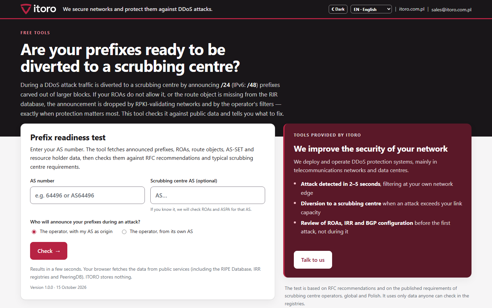
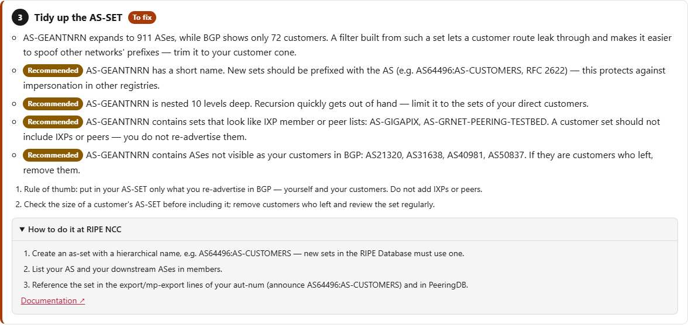
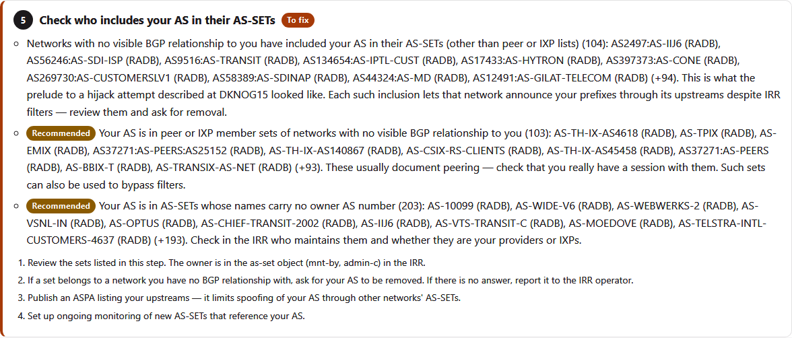
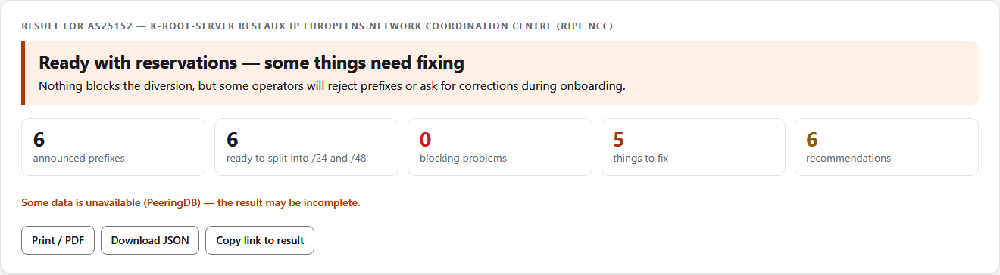
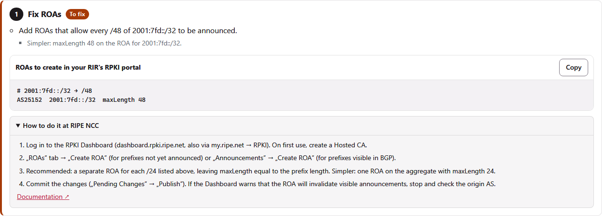
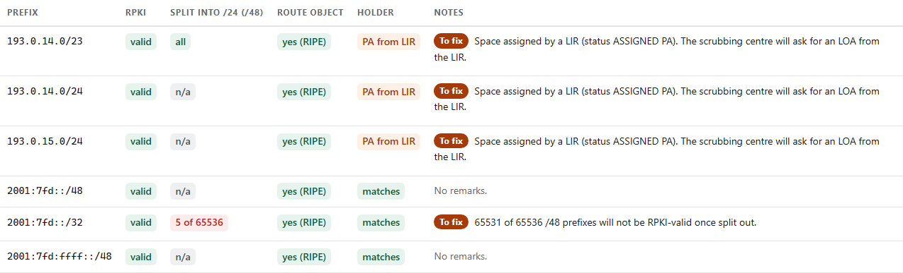
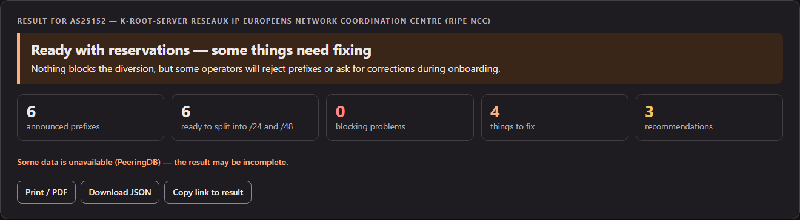
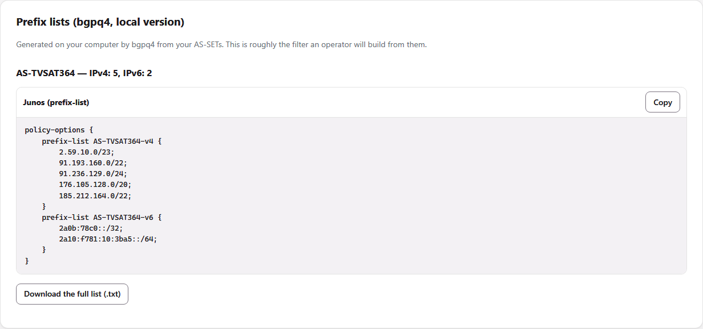

# Scrubbing centre prefix readiness test


Enter an AS number and check whether your prefixes can be diverted to a
DDoS scrubbing centre during an attack: whether every /24 (/48) split out of
your blocks will be RPKI-valid, whether route objects live in a RIR database,
whether an LOA will be needed, and whether AS-SET, abuse contact, PeeringDB
and ASPA are in order. It also checks the **hygiene of your AS-SET** — how big
it really is, what it pulls in and **who else has put your AS into their
AS-SETs**. The tool then walks you through the fixes step by step, with
instructions for your own registry — RIPE NCC, ARIN, APNIC, AFRINIC or
LACNIC — and ready-to-paste ROA, route object and LOA drafts. The
[downloadable version](#running-it-yourself) adds prefix lists built with
bgpq4.

Everything runs in the browser. There is no server and no account; the
browser queries public services directly. Published by
[ITORO](https://itoro.com.pl) — we protect operator and data centre networks
against DDoS attacks.

**[Wersja polska → README.pl.md](README.pl.md)** ·
**Live: https://itoro.com.pl/narzedzia/scrubbing/**



---

## Why

During an attack that exceeds link capacity, traffic is diverted to a
scrubbing centre by announcing /24 prefixes carved out of larger blocks.
If the ROA was created exactly on the aggregate, every /24 becomes
RPKI-invalid and is dropped by validating networks. RPKI and IRR changes take
hours to reach filters — RFC 9319 §5.1 says the ROA must exist before the
attack. This test finds such gaps in advance.

## What it checks

**AS level:** AS exists and announces prefixes · abuse contact · aut-num and
the AS-SET in its export policy · AS-SET contains your AS, lives in a RIR
database and has a hierarchical name · AS-SET in PeeringDB · at least two
upstreams · ASPA (includes the scrubbing centre's AS) · ROAs for the
scrubbing centre's AS when it originates · stale route objects.

**AS-SET hygiene:** expanded size against customers visible in BGP · nesting
depth · largest member sets · IXP/peer sets inside a customer set · members not
seen in BGP · **who includes your AS in their AS-SETs** — see
[AS-SET hygiene](#as-set-hygiene) below.

**Prefix level:** length ≤ /24 and ≤ /48 · RPKI state · **how many /24 (/48)
blocks will be RPKI-valid after splitting** · broad maxLength · AS0 ROAs ·
other-AS ROAs · route object in a RIR database (not RADB, not RIPE-NONAUTH) ·
route objects for every /24 · route objects with another origin · resource
holder different from the AS holder, or PA space from a LIR (LOA needed) ·
less specific announced by another AS (upstream LOA needed).

The basis for every test — RFCs, RIPE and RIR documents, talks and articles,
scrubbing provider documentation — is listed with authors and links in
[Sources and credits](#sources-and-credits) at the bottom of this page.

## AS-SET hygiene

An AS-SET is what your upstreams — and a scrubbing centre — use to build the
filter for routes they accept from you. RPKI ROAs validate only the origin AS;
the transit part of the path is protected by these RPSL-based filters. That
makes the AS-SET a security object, not documentation:

- **Too big:** if your AS-SET expands to thousands of ASes, a route leak from
  one of your customers passes your upstream's filter. Thousands of AS-SETs on
  the Internet expand to over 1,000 ASes, some to more than the whole routing
  table (Doug Madory, Job Snijders, 2025).
- **Wrong content:** an AS-SET used for filtering should list your customer
  cone only. IXP member lists and peer lists inside it make it explode.
  Rule of thumb from Lasse Jarlskov: *would you re-advertise this in BGP?*
  If not, it does not belong in your AS-SET.
- **Included by others:** anyone can add your AS to their AS-SET. With a
  spoofed origin the announcement is ROA-valid and passes RPSL-based transit
  filters — this is how the prelude to a hijack attempt presented at DKNOG15
  looked. Defence: review who includes you, ask for removal, publish ASPA and
  monitor the IRRs.

The tool checks:

| Check | Flagged when | Step in the action plan |
|---|---|---|
| Size of each of your AS-SETs | it expands to more than 1,000 ASes or 10× the customers visible in BGP (*to fix*); over 3× (*recommended*) | Tidy up the AS-SET |
| Nesting depth | more than 5 levels | Tidy up the AS-SET |
| Largest member sets | a member set brings at least 100 ASes and 30 % of the total | Tidy up the AS-SET |
| IXP and peer sets inside a customer set | member names look like IXP or peer lists | Tidy up the AS-SET |
| Members not seen in BGP | a direct member is not visible as your customer | Tidy up the AS-SET |
| Who includes your AS | AS-SETs of networks with no visible BGP relationship (*to fix*); peer/IXP lists and sets without an owner AS in the name (*recommended*) | Check who includes your AS in their AS-SETs |
| Prefix counts and prefix lists | local version with bgpq4 only | Prefix lists section |





## What you get

| | |
|---|---|
| **Verdict** | not ready / ready with reservations / ready, with counters |
| **Action plan** | steps in the order worth following, each with instructions for your RIR and a link to its documentation |
| **Ready objects** | ROAs (per /24 per RFC 9319, or maxLength on the aggregate), route objects in RPSL, an LOA draft with prefixes and holders |
| **AS-SET hygiene** | size, depth, largest members, IXP/peer sets, stale members, who includes your AS |
| **Prefix table** | RPKI state, how many /24 (/48) are valid after splitting, route object, holder |
| **Prefix lists** (local version) | prefix counts of your AS-SETs, Junos `prefix-list`, full list as .txt (bgpq4) |
| **Manual checklist** | LOA, tunnel and MSS, propagation time, announcement and withdrawal, routing loops, customer filtering, dry run, RTBH |
| **Export** | print to PDF, JSON |







<sub>Screenshots: AS25152 (K-root, RIPE NCC), 15 October 2026. The tool has a light and a dark theme:</sub>



## Languages

Polish, English, German, French, Spanish, Portuguese, Italian, Dutch, Czech
and Romanian. The page picks the browser language and offers a switcher;
`?jezyk=<code>` forces one. Polish and English are built in (`napisy.js`,
`rir.js`); the other languages load on demand from `jezyki/<code>.js`.

## Running it yourself

You can use the tool online at **https://itoro.com.pl/narzedzia/scrubbing/**
or download it and run it on your own computer. The downloaded version does
everything the online one does and, with **bgpq4** installed, adds **prefix
lists** generated from your AS-SETs (prefix counts, Junos `prefix-list`,
plain lists to download). Prefix lists exist only in the local version: they
need bgpq4, which talks to IRR servers directly, and a web page cannot do that
from your browser.



### 1. Download

- **ZIP:** [download the current version](https://github.com/itoro-pl/scrubbing-readiness-test/archive/refs/heads/main.zip)
  (the same as **Code → Download ZIP** on the repository page). Numbered
  versions are on the [Releases](https://github.com/itoro-pl/scrubbing-readiness-test/releases)
  page. Unpack it anywhere.
- **git:** `git clone https://github.com/itoro-pl/scrubbing-readiness-test.git`

### 2. Choose how to run it

| Option | You need | Prefix lists (bgpq4) |
|---|---|---|
| **A. Windows** — double-click `start.bat` | [Python 3.8+](https://www.python.org/downloads/) (tick *Add python.exe to PATH* during installation) | no — use option C if you want them |
| **B. Linux / macOS** — run `./start.sh` | Python 3 (usually already installed) + `bgpq4` (Debian/Ubuntu: `sudo apt install bgpq4`, macOS: `brew install bgpq4`) | yes, once bgpq4 is installed |
| **C. Docker** (Windows, Linux, macOS) | [Docker Desktop](https://www.docker.com/products/docker-desktop/) on Windows/macOS, or Docker Engine on Linux | yes, bgpq4 is inside the image |

**Do I need Docker for Windows?** Only if you want prefix lists on Windows.
For everything else `start.bat` and Python are enough. (Alternatively, install
bgpq4 in WSL and run `./start.sh` there.)

### 3. Start

**A — Windows:** double-click `start.bat`. The browser opens at
`http://127.0.0.1:8765/`. Close the window (or press Ctrl+C) to stop.

**B — Linux / macOS:**

```bash
./start.sh
```

**C — Docker**, in the unpacked folder:

```bash
docker compose up --build
```

then open `http://127.0.0.1:8765/`. Without Compose:

```bash
docker build -t itoro-scrubbing .
docker run --rm -p 127.0.0.1:8765:8765 itoro-scrubbing
```

Options of the local server: `start.bat --port 9000`, `./start.sh --port 9000`,
`--bez-przegladarki` (do not open the browser). The server listens only on
`127.0.0.1`; the Docker example publishes the port on `127.0.0.1` too.

The local server (`serwer.py`, Python standard library only) serves the files
and two endpoints used only by the local page: `/api/status` and
`/api/prefiksy?zbior=<AS-SET>&ip=4|6[&zrodlo=<IRR>]`, which run `bgpq4 -j`.
Input is validated and bgpq4 is called without a shell.

Language: `?jezyk=pl`, `en`, `de`, `fr`, `es`, `pt`, `it`, `nl`, `cs`, `ro` (default: browser language). Direct
result: `?as=64496`, optionally `&op=<scrubbing AS>&tryb=operator`.

## Data sources

| Data | Service |
|---|---|
| announced prefixes, ROAs and ASPA, BGP neighbours | RIPEstat Data API |
| route objects in all IRRs, AS-SET expansion, AS-SETs that include your AS | IRR Explorer (NLNOG) |
| resource holder, abuse contact (all RIRs) | RDAP, server chosen by the IANA bootstrap |
| aut-num export policy (RIPE region) | RIPE Database REST API |
| AS-SET used for filters | PeeringDB API |
| prefix lists (local version only) | bgpq4 on your computer |

All of them send CORS headers. If you host the tool behind a
Content-Security-Policy, allow in `connect-src`:
`https://stat.ripe.net https://rest.db.ripe.net https://irrexplorer.nlnog.net https://www.peeringdb.com https://data.iana.org https://rdap.db.ripe.net https://rdap.arin.net https://rdap.apnic.net https://rdap.afrinic.net https://rdap.lacnic.net https://rdap.registro.br https://rdap.org`.

## Repository layout

| Path | Contents |
|---|---|
| `index.html` | the page |
| `app.js` | tests, RDAP lookups and result view; no external libraries |
| `napisy.js` | all interface texts, PL and EN |
| `rir.js` | step-by-step instructions for RIPE NCC, ARIN, APNIC, AFRINIC, LACNIC (PL and EN) |
| `jezyki/` | DE, FR, ES, PT, IT, NL, CS, RO — interface and RIR instructions |
| `zrzuty/` | screenshots used in this README |
| `serwer.py`, `start.bat`, `start.sh` | local server (Python stdlib) with the optional bgpq4 endpoint; one-click start |
| `Dockerfile`, `docker-compose.yml` | image with Python and bgpq4 |
| `skrypty/` | QA: `node skrypty/sprawdz-jezyki.js .` (translation structure), `python skrypty/sprawdz-uklad.py <url> <AS>` (layout in all languages), `python skrypty/zrzuty.py <url> <AS> zrzuty pl en` (screenshots; Playwright) |
| `style.css` | light and dark theme, WCAG 2.1 AA contrast |
| `CHANGELOG.md` | version history (EN, PL) |

## Privacy

There is no ITORO server. The AS number goes from your browser straight to
the public services above. The result can be printed to
PDF or saved as JSON.

## Limitations

- Large networks: prefix-level lookups cover the first 150 prefixes.
- Requirements not published by providers (LOA wording, tunnels, BGP
  communities) are listed as a manual checklist, not tested.
- RIR portals change their menus; every instruction links to the RIR's own
  documentation.

## What's new

**1.1.0 — 17 October 2026:** AS-SET hygiene checks, „who includes your AS”,
downloadable version (`start.bat`, `start.sh`, Docker with bgpq4) with prefix
lists, full author names in sources. **1.0.0 — 15 October 2026:** first release.
Details in [CHANGELOG.md](CHANGELOG.md).

## Sources and credits

The tests follow four kinds of sources: IETF RFCs; RIPE NCC documents and the
documentation of the RIPE Database and other RIRs; operator talks and articles
on AS-SET hygiene; and the public onboarding documentation of well-known DDoS
mitigation (scrubbing) providers. Checked on 15–17 October 2026.
Where a provider does not publish a requirement, we say so instead of guessing.

### 1. IETF RFCs

| Document | What we take from it | Test in the tool |
|---|---|---|
| [RFC 6811](https://www.rfc-editor.org/rfc/rfc6811) — BGP Prefix Origin Validation | the three states: valid, invalid, not found | RPKI state of each announced prefix |
| [RFC 9319](https://www.rfc-editor.org/rfc/rfc9319) (BCP 185) — The Use of maxLength in the RPKI, §5 | use minimal ROAs, avoid maxLength unless it has no effect | „broad maxLength” recommendation; ROA suggestions in two variants (separate ROAs per /24, or maxLength on the aggregate) with the trade-off explained |
| RFC 9319, §5.1 — ROAs for DDoS mitigation services | a provider that announces the customer's prefix needs its own ROA, and the ROA must exist **before** the attack because RPKI propagates slower than BGP | ROA check for the scrubbing provider's AS („operator announces from its own AS” mode); propagation warning |
| RFC 9319, §6 — RTBH (RTDR) | do not widen ROAs (maxLength, very specific prefixes) to support RTBH | item in „what cannot be checked from outside” |
| [RFC 9582](https://www.rfc-editor.org/rfc/rfc9582) — A Profile for ROAs | maxLength equal to the prefix length is not encoded; ROA semantics | ROA coverage calculation |
| [RFC 6483](https://www.rfc-editor.org/rfc/rfc6483) — Validation of Route Origination, §4 | an AS0 ROA means the prefix must not be routed | AS0 ROA check |
| [RFC 7454](https://www.rfc-editor.org/rfc/rfc7454) (BCP 194) — BGP Operations and Security, §6.1.3 | IPv4 prefixes longer than /24 and IPv6 longer than /48 are commonly filtered; IRR as the basis for prefix filters | prefix length check; split target /24 and /48; route object checks |
| [RFC 2622](https://www.rfc-editor.org/rfc/rfc2622) — RPSL, §5 | hierarchical set names (AS64496:AS-NAME) | AS-SET name check |
| [RFC 7999](https://www.rfc-editor.org/rfc/rfc7999) — BLACKHOLE community | RTBH signalling, separate from diversion | context for the RTBH note |
| ASPA — IETF SIDROPS ([draft-ietf-sidrops-aspa-profile](https://datatracker.ietf.org/doc/draft-ietf-sidrops-aspa-profile/), [draft-ietf-sidrops-aspa-verification](https://datatracker.ietf.org/doc/draft-ietf-sidrops-aspa-verification/)) | a customer's ASPA must list every provider AS on the path | ASPA must include the scrubbing provider's AS |

### 2. RIPE NCC and the RIPE Database

| Document | What we take from it | Test in the tool |
|---|---|---|
| [ripe-705](https://www.ripe.net/publications/docs/ripe-705) — Abuse Contact Management in the RIPE Database | abuse-c is mandatory for aut-num and for directly allocated inetnum/inet6num | abuse contact check |
| [RIPE Database documentation — Set objects](https://docs.db.ripe.net/Set-Objects/) | new as-set objects must have hierarchical names; existing short names stay valid | AS-SET name check (recommendation, not an error) |
| [RIPE Database documentation — Protection of objects with hierarchical names](https://docs.db.ripe.net/Authorisation/Protection-of-Objects-with-Hierarchical-Names/) | creation of a hierarchical set is authorised by the parent object | rationale for the recommendation |
| [RIPE Labs — Out-of-region route(6) and aut-num objects](https://labs.ripe.net/author/denis/out-of-region-route6-and-aut-num-objects-in-the-ripe-database/) | out-of-region objects moved to source RIPE-NONAUTH (since 4 September 2018) | RIPE-NONAUTH is not treated as an authoritative IRR |
| [RIPEstat Data API](https://stat.ripe.net/docs/data-api/) | announced prefixes, ROAs and ASPA, abuse contact, BGP neighbours | data source |
| [RIPE Database REST API](https://docs.db.ripe.net/RIPE-Database-Structure/REST-API-Data-model/) | aut-num, as-set, inetnum/inet6num (holder organisation, status PA/PI) | AS-SET contents; LOA need (other organisation, PA space from a LIR) |

### 3. RIR documentation used for the step-by-step instructions

| RIR | ROA | IRR (route, as-set) | abuse contact | ASPA |
|---|---|---|---|---|
| RIPE NCC | [ROA management](https://www.ripe.net/manage-ips-and-asns/resource-management/rpki/resource-certification-roa-management/) | [RIPE Database docs](https://docs.db.ripe.net/) | [abuse-c FAQ](https://www.ripe.net/manage-ips-and-asns/resource-management/faqs-for-abuse-c/) | [ASPA in the RPKI Dashboard](https://labs.ripe.net/author/tim_bruijnzeels/aspa-in-the-rpki-dashboard-a-new-layer-of-routing-security/) |
| ARIN | [Hosted RPKI](https://www.arin.net/resources/manage/rpki/options/hosted/) | [ARIN IRR user guide](https://www.arin.net/resources/manage/irr/userguide/) | [POC records](https://www.arin.net/resources/guide/account/records/poc/) | [ASPA](https://www.arin.net/resources/manage/rpki/aspa/) |
| APNIC | [Creating ROAs in MyAPNIC](https://blog.apnic.net/2019/09/11/how-to-creating-rpki-roas-in-myapnic/) | [as-set guide](https://www.apnic.net/manage-ip/using-whois/guide/as-set/) | [abuse-c](https://www.apnic.net/about-apnic/service-updates/apnic-whois-database-abuse-c/) | [ASPA at APNIC](https://blog.apnic.net/2026/07/09/aspa-at-apnic-strengthening-bgp-path-validation/) |
| AFRINIC | [RPKI](https://afrinic.net/support/rpki) | [route objects](https://afrinic.net/support/irr/on-myafrinic/creating-route-object), [as-set](https://afrinic.net/support/irr/on-myafrinic/create-as-set-objects) | [abuse contact](https://afrinic.net/support/how-to-publish-abuse-contact-information) | not announced (October 2026) |
| LACNIC | [IRR (route objects generated from ROAs)](https://www.lacnic.net/5921/2/lacnic/internet-routing-registry-irr) | [IRR help](https://lacnic.zendesk.com/hc/es/categories/360002625214-Internet-Routing-Registry) | [LAC-2018-5](https://politicas.lacnic.net/politicas/detail/id/LAC-2018-5) | [announcement, October 2026](https://blog.lacnic.net/en/caribnog-lacnic/) |

Resource holder and abuse data for every RIR come from RDAP; the
authoritative server is found through the [IANA RDAP bootstrap](https://data.iana.org/rdap/)
([RFC 9224](https://www.rfc-editor.org/rfc/rfc9224)).

### 4. AS-SET hygiene — talks and articles

| Author(s) | Title, venue, date | What we take from it | Test in the tool |
|---|---|---|---|
| Lasse Jarlskov (Telia Company) | „Securing your AS-set”, [BalticNOG 2025](https://events.balticnog.org/event/1/contributions/51/), Vilnius, 25 September 2025; same talk at the Netnod meeting, 8 October 2025 ([slides, PDF](https://www.netnod.se/sites/default/files/2025-10/10.Securing%20your%20AS-Set-Netnod.pptx_.pdf)) | three AS-SET types (customers, peers, IXP members) — only the customer set is used to build filters; rule of thumb „would you re-advertise this in BGP?”; bigger is not better, recursion is dangerous; clean up regularly; check your customers' AS-SET sizes; check who includes you | AS-SET size against BGP customers, nesting depth, largest member sets, IXP/peer sets inside a customer set, members not seen in BGP, who includes your AS |
| Lasse Jarlskov (Telia Company); ASPA part with Job Snijders | „Prelude to a BGP hijack?”, [DKNOG15](https://events.dknog.dk/event/32/contributions/297/), Copenhagen, 7 March 2025 ([video](https://www.youtube.com/watch?v=ejwp6b6lVWQ)) | anyone can put your AS in their AS-SET; with a spoofed origin the route is ROA-valid and passes RPSL-based transit filters; defence: ASPA and monitoring IRRs for new references to your AS | who includes your AS (sets of networks with no BGP relationship are flagged); ASPA recommendation; monitoring step |
| Doug Madory, Job Snijders | [„The Scourge of Excessive AS-SETs”](https://www.kentik.com/blog/the-scourge-of-excessive-as-sets/), Kentik blog, 23 April 2025 | thousands of AS-SETs expand to over 1,000 ASNs, some beyond the whole routing table; such filters did not stop real route leaks; keep membership minimal, avoid recursion, use hierarchical names, name the authoritative IRR source in PeeringDB | AS-SET size and depth, hierarchical name, PeeringDB AS-SET with source |
| MANRS | [„Module 2: IRRs, RPKI, and PeeringDB”](https://manrs.org/resources/training/tutorials/irrs-rpki-peeringdb/) (MANRS training) | document your customer cone with an as-set (e.g. AS64500:AS-CUSTOMERS), register route objects, publish routing policy in aut-num, keep PeeringDB up to date | AS-SET in aut-num export, AS-SET contains your AS, PeeringDB |

### 5. Other sources

| Source | What we take from it |
|---|---|
| [MANRS — Network Operators](https://manrs.org/netops/) | register routing intent in IRR and RPKI, keep contacts up to date (RIR database, PeeringDB) |
| [IRR Explorer (NLNOG)](https://irrexplorer.nlnog.net/) | route objects from all IRRs with their RPKI status — data source |
| [PeeringDB API](https://www.peeringdb.com/apidocs/) | the AS-SET many operators use to build filters — data source |

### 6. Scrubbing provider documentation

The tool itself does not name providers; it refers to „typical requirements of
scrubbing centre operators”. The list below is what those requirements are
based on.

| Provider | Published requirements | Source |
|---|---|---|
| Cloudflare Magic Transit | minimum /24; IRR entries must match the origin AS; LOA (from the ISP as well if the ISP announces); GRE or IPsec with MSS clamping (≤1436 / ≤1360) set before cut-over; safe withdrawal: announce from your own network first | [prerequisites](https://developers.cloudflare.com/magic-transit/prerequisites/), [advertise prefixes](https://developers.cloudflare.com/magic-transit/how-to/advertise-prefixes/) |
| Cloudflare BYOIP | IPv4 /24, IPv6 /48; prefix in one of the five RIRs; exact route/route6 object with the announcing origin (an RPKI-derived IRR entry is not enough); ROA verified; at least 5 h provisioning | [get started](https://developers.cloudflare.com/byoip/get-started/), [IRR best practices](https://developers.cloudflare.com/byoip/concepts/irr-entries/best-practices/) |
| Lumen DDoS Mitigation | off-net minimum /24 and /48; a customer with ROAs must add a ROA for the Lumen AS or ROV networks drop the announcement; the customer must ignore more specifics of its own space sent back by Lumen | [service guide](https://www.lumen.com/en-us/about/legal/ddos-mitigation-service-guide.html) |
| Link11 | only /24 prefixes; route object in an authoritative RIR database, recognised within 48 h; public AS required | [FAQ](https://docs.link11.com/product-guides/network-ddos/faq/general-questions) |
| F5 Distributed Cloud Routed DDoS | /24 or shorter; authoritative IRR (RIPE, ARIN…); ROA required; LOA for prefixes the customer does not hold | [L3/L4 DDoS mitigation](https://docs.cloud.f5.com/docs-v2/ddos-and-transit-services/how-tos/network-firewall/l3l4-ddos-mitigation) |
| Gcore | prefix from /8 to /24; public AS; LOA mandatory; GRE MTU 1476 / MSS 1436 | [network submission](https://docs.gcore.com/ddos-protection/onboarding-service/network-submission) |
| OVHcloud BYOIP | IPv4 /24–/19; inetnum must match the range exactly (PA, PI, LEGACY); route object with the OVHcloud or customer origin; range not announced elsewhere | [Bring your own IP](https://docs.ovhcloud.com/en/guides/network/bring-your-own-ip/bring-your-own-ip) |
| NASK anti-DDoS (Poland), variant II | AS from RIPE NCC; mask up to /24 (larger blocks protected as a set of /24s); the customer must be able to create route objects and change ROAs; prepend or suppress the /24 to transit | [regulations, annex](https://www.nask.pl/media/2025/01/ADDoS-Zalacznik-nr-2-_-Zalacznik-nr-1_do_Regulaminu.pdf) |
| Akamai Prolexic Routed | GRE (RFC 2784) with keepalives, MSS 1436 / 1380, decapsulation capacity ≥ 2× CIR. ROA/IRR/LOA requirements are not published | [service descriptions](https://www.akamai.com/site/en/documents/akamai-services-descriptions.pdf) |
| Imperva DDoS Protection for Networks | GRE to at least two data centres; in always-on mode Imperva must be the best path (prepend, local-pref or a more specific prefix). ROA/IRR/LOA requirements are not published | [documentation](https://docs.imperva.com/) |

Not used, because no public technical requirements were found: Radware,
NETSCOUT Arbor Cloud, Corero, Voxility, Path.net and Polish operators other
than NASK.

### 7. From sources to tests

| Test | Sources |
|---|---|
| Every /24 (/48) split out of an announced block is RPKI-valid | RFC 6811, RFC 9319 §5.1, RFC 7454; Link11, NASK, Cloudflare |
| Prefix not longer than /24 (/48) | RFC 7454 §6.1.3; Cloudflare, Lumen, Link11, F5, Gcore, NASK |
| Route object with your AS in a RIR database (not RADB, not RIPE-NONAUTH, not RPKI-derived) | RFC 7454; RIPE Labs (RIPE-NONAUTH); Cloudflare BYOIP, Link11, F5 |
| Route object for each /24 that may be announced | Cloudflare BYOIP (exact match), Link11, NASK |
| LOA when the space belongs to another organisation or is PA from a LIR | Cloudflare, F5, Gcore |
| ROA for the provider's AS when it originates | RFC 9319 §5.1; Lumen |
| ASPA includes the provider's AS | IETF SIDROPS ASPA |
| abuse-c | ripe-705; MANRS |
| AS-SET contains your AS, hierarchical name | RFC 2622; RIPE Database documentation; MANRS |
| AS0 ROA, conflicting route objects with another origin | RFC 6483; RFC 6811 |
| AS-SET size, depth, largest members, IXP/peer sets, members not seen in BGP | Lasse Jarlskov (BalticNOG 2025); Doug Madory and Job Snijders (2025); MANRS module 2 |
| Who includes your AS in their AS-SETs | Lasse Jarlskov (BalticNOG 2025, DKNOG15) |
| Broad maxLength (recommendation) | RFC 9319 §5 |

## Licence

Code: **AGPL-3.0-or-later** (file `LICENSE`).
Substantive content — test descriptions, RIR instructions, interface texts,
documentation: **CC BY-SA 4.0** (file `LICENSE-TRESC.md`).
Data from external services and the ITORO trademark — see `NOTICE`.

---

## About ITORO

We deploy and operate DDoS protection systems, mainly in telecommunications
networks and data centres. https://itoro.com.pl
