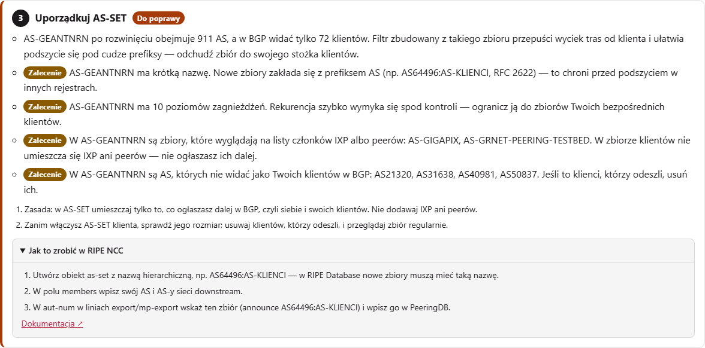
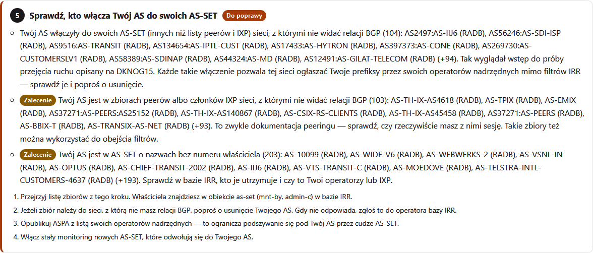
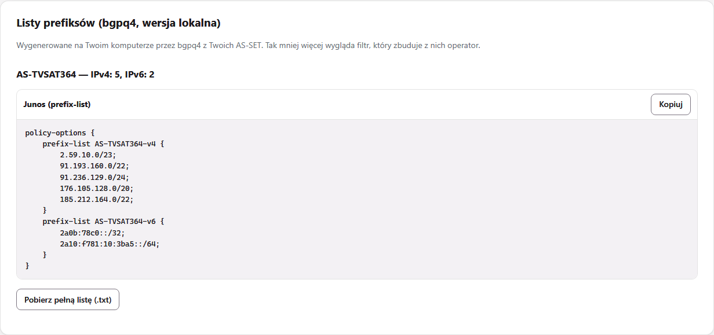

# Test gotowości prefiksów do scrubbing center


Wpisz numer AS i sprawdź, czy Twoje prefiksy da się przekierować do scrubbing center w czasie ataku DDoS. Narzędzie sprawdza, czy każdy /24 (/48) wydzielony z Twoich bloków będzie RPKI-valid i czy obiekty route są w bazie RIR. Ocenia też, czy będzie potrzebne LOA, oraz czy w porządku są AS-SET, kontakt abuse, PeeringDB i ASPA. Sprawdza **higienę AS-SET**: jak duży naprawdę jest Twój zbiór, co do niego trafia i **kto jeszcze dopisał Twój AS do swoich AS-SET**. Potem prowadzi przez poprawki krok po kroku, z instrukcją dla Twojego rejestru (RIPE NCC, ARIN, APNIC, AFRINIC albo LACNIC) i z gotowymi ROA, obiektami route oraz wzorem LOA do wklejenia. [Wersja do pobrania](#uruchomienie-na-własnym-komputerze) dodaje listy prefiksów budowane przez bgpq4.

Wszystko działa w przeglądarce. Nie ma serwera ani konta, a przeglądarka odpytuje publiczne serwisy bezpośrednio. Narzędzie udostępnia [ITORO](https://itoro.com.pl): chronimy sieci operatorów i centrów danych przed atakami DDoS.

**[English version → README.md](README.md)** ·
**Wersja online: https://itoro.com.pl/narzedzia/scrubbing/?jezyk=pl**


---

## Po co

Gdy atak przekracza przepustowość łączy, ruch kieruje się do scrubbing center przez ogłoszenie prefiksów /24 wydzielonych z większych bloków. Jeżeli ROA założono dokładnie na agregat, każdy taki /24 jest RPKI-invalid i sieci walidujące RPKI go odrzucają. Zmiany w RPKI i IRR docierają do filtrów po kilku godzinach, a RFC 9319 §5.1 mówi wprost, że ROA musi istnieć przed atakiem. Ten test wykrywa takie luki zawczasu.

## Co sprawdza

**Na poziomie AS:**
- AS istnieje i ogłasza prefiksy;
- kontakt abuse;
- aut-num i AS-SET w polityce eksportu;
- AS-SET zawiera Twój AS, jest w bazie RIR i ma nazwę hierarchiczną;
- AS-SET w PeeringDB;
- co najmniej dwóch operatorów nadrzędnych;
- **ASPA**: providerzy widoczni w BGP, a brakujący w ASPA; wpisy niewidoczne w BGP; ASPA bez providerów (AS0) mimo widocznych operatorów nadrzędnych; AS operatora scrubbing center; gotowa propozycja obiektu ASPA;
- ROA dla AS operatora, gdy to on jest źródłem ogłoszenia;
- nieaktualne obiekty route.

**Higiena AS-SET** (szczegóły w sekcji [Higiena AS-SET](#higiena-as-set)):
- rozmiar po rozwinięciu wobec klientów widocznych w BGP;
- głębokość zagnieżdżeń i największe składowe;
- zbiory IXP i peerów w zbiorze klientów;
- członkowie niewidoczni w BGP;
- **kto włącza Twój AS do swoich AS-SET**.

**Na poziomie prefiksu:**
- długość nie większa niż /24 i /48;
- stan RPKI;
- **ile bloków /24 (/48) będzie RPKI-valid po podziale**;
- szerokie maxLength, ROA z AS0, ROA innych AS;
- obiekt route w bazie RIR (nie RADB, nie RIPE-NONAUTH), także dla każdego /24;
- obiekty route z innym origin;
- właściciel przestrzeni inny niż właściciel AS albo przestrzeń PA od LIR (potrzebne LOA);
- mniej szczegółowy prefiks ogłaszany przez inny AS (potrzebne LOA od operatora nadrzędnego).

Podstawę każdego testu (RFC, dokumenty RIPE i RIR, wystąpienia i artykuły, dokumentację operatorów) z autorami i odnośnikami opisuje sekcja [Źródła i autorzy](#źródła-i-autorzy) na dole tej strony.

## Higiena AS-SET

Z AS-SET Twoi operatorzy nadrzędni, a także scrubbing center, budują filtr tras, które od Ciebie przyjmują. ROA w RPKI sprawdza tylko AS źródłowy; tranzytową część ścieżki chronią właśnie filtry RPSL. Dlatego AS-SET jest obiektem bezpieczeństwa, a nie tylko dokumentacją:

- **Za duży zbiór:** jeśli Twój AS-SET rozwija się do tysięcy AS, wyciek tras od jednego z klientów przejdzie przez filtr operatora nadrzędnego. W internecie są tysiące AS-SET obejmujących ponad 1000 AS, a niektóre są większe niż cała tablica routingu (Doug Madory, Job Snijders, 2025).
- **Zła zawartość:** zbiór używany do filtrowania powinien obejmować tylko Twój stożek klientów. Listy członków IXP i peerów w środku sprawiają, że zbiór puchnie. Zasada Lassego Jarlskova: *czy ogłosiłbyś to dalej w BGP?* Jeśli nie, nie wpisuj tego do AS-SET.
- **Włączenie przez innych:** każdy może dopisać Twój AS do swojego AS-SET. Przy sfałszowanym AS źródłowym ogłoszenie jest zgodne z ROA i przechodzi filtry RPSL operatora tranzytowego. Tak wyglądał wstęp do próby przejęcia ruchu pokazany na DKNOG15. Obrona: sprawdzaj, kto Cię włącza, proś o usunięcie, opublikuj ASPA i monitoruj bazy IRR.

Narzędzie sprawdza:

| Test | Kiedy jest oznaczany | Krok planu działań |
|---|---|---|
| Rozmiar każdego Twojego AS-SET | rozwija się do ponad 1000 AS albo 10 razy więcej, niż masz klientów w BGP (*do poprawy*); ponad 3 razy więcej (*zalecenie*) | Uporządkuj AS-SET |
| Głębokość zagnieżdżeń | więcej niż 5 poziomów | Uporządkuj AS-SET |
| Największe składowe | zbiór składowy wnosi co najmniej 100 AS i 30% całości | Uporządkuj AS-SET |
| Zbiory IXP i peerów w zbiorze klientów | nazwy składowych wyglądają na listy IXP albo peerów | Uporządkuj AS-SET |
| Członkowie niewidoczni w BGP | bezpośredniego członka nie widać jako Twojego klienta | Uporządkuj AS-SET |
| Kto włącza Twój AS | AS-SET sieci bez widocznej relacji BGP (*do poprawy*); listy peerów i IXP oraz zbiory bez numeru właściciela w nazwie (*zalecenie*) | Sprawdź, kto włącza Twój AS do swoich AS-SET |
| Liczba prefiksów i listy prefiksów | tylko w wersji lokalnej z bgpq4 | sekcja Listy prefiksów |





## Co dostajesz

| | |
|---|---|
| **Werdykt** | niegotowe / gotowe z zastrzeżeniami / gotowe, z licznikami |
| **Plan działań** | kroki w kolejności wykonania, każdy z instrukcją dla Twojego RIR i odnośnikiem do jego dokumentacji |
| **Gotowe obiekty** | ROA (osobno dla każdego /24 według RFC 9319 albo maxLength na agregacie), obiekty route w RPSL, wzór LOA z prefiksami i ich właścicielami |
| **Higiena AS-SET** | rozmiar, głębokość, największe składowe, zbiory IXP i peerów, nieaktualni członkowie, kto włącza Twój AS |
| **Tabela prefiksów** | stan RPKI, ile /24 (/48) będzie valid po podziale, obiekt route, właściciel |
| **Listy prefiksów** (wersja lokalna) | liczba prefiksów w Twoich AS-SET, `prefix-list` dla Junos, pełna lista jako .txt (bgpq4) |
| **Lista kontrolna** | LOA, tunel i MSS, czas propagacji, ogłoszenie i wycofanie, pętle routingu, filtrowanie klientów, test na sucho, RTBH |
| **Eksport** | druk do PDF, JSON |


<sub>Zrzuty: AS25152 (K-root, RIPE NCC), 15 października 2026. Narzędzie ma motyw jasny i ciemny:</sub>


## Języki

Polski, angielski, niemiecki, francuski, hiszpański, portugalski, włoski, niderlandzki, czeski i rumuński. Strona wybiera język przeglądarki i ma przełącznik, a parametr `?jezyk=<kod>` wymusza wybrany język. Polski i angielski są wbudowane (`napisy.js`, `rir.js`); pozostałe języki ładują się z `jezyki/<kod>.js` dopiero wtedy, gdy są potrzebne.

## Uruchomienie na własnym komputerze

Z narzędzia można korzystać online pod adresem **https://itoro.com.pl/narzedzia/scrubbing/** albo pobrać je i uruchomić u siebie. Wersja pobrana robi wszystko to, co wersja online. Gdy masz zainstalowany **bgpq4**, dochodzą **listy prefiksów** budowane z Twoich AS-SET: liczba prefiksów, gotowe `prefix-list` dla Junos i zwykłe listy do pobrania. Listy prefiksów są tylko w wersji lokalnej. bgpq4 łączy się bezpośrednio z serwerami IRR, a strona w przeglądarce tego nie potrafi.



### 1. Pobranie

- **ZIP:** [pobierz aktualną wersję](https://github.com/itoro-pl/scrubbing-readiness-test/archive/refs/heads/main.zip). To to samo co przycisk **Code → Download ZIP** na stronie repozytorium. Numerowane wersje są na stronie [Releases](https://github.com/itoro-pl/scrubbing-readiness-test/releases). Rozpakuj w dowolnym miejscu.
- **git:** `git clone https://github.com/itoro-pl/scrubbing-readiness-test.git`

### 2. Wybór sposobu uruchomienia

| Sposób | Czego potrzebujesz | Listy prefiksów (bgpq4) |
|---|---|---|
| **A. Windows**: dwuklik na `start.bat` | [Python 3.8+](https://www.python.org/downloads/) (przy instalacji zaznacz *Add python.exe to PATH*) | nie; jeśli ich potrzebujesz, wybierz sposób C |
| **B. Linux / macOS**: `./start.sh` | Python 3 (zwykle już jest) i `bgpq4` (Debian/Ubuntu: `sudo apt install bgpq4`, macOS: `brew install bgpq4`) | tak, po zainstalowaniu bgpq4 |
| **C. Docker** (Windows, Linux, macOS) | [Docker Desktop](https://www.docker.com/products/docker-desktop/) na Windows i macOS albo Docker Engine na Linuksie | tak, bgpq4 jest w obrazie |

**Czy potrzebuję Dockera na Windowsie?** Tylko wtedy, gdy chcesz mieć listy prefiksów na Windowsie. Do całej reszty wystarczą `start.bat` i Python. Można też zainstalować bgpq4 w WSL i uruchomić tam `./start.sh`.

### 3. Uruchomienie

**A, Windows:** dwuklik na `start.bat`. Przeglądarka otworzy `http://127.0.0.1:8765/`. Żeby zatrzymać narzędzie, zamknij okno albo naciśnij Ctrl+C.

**B, Linux / macOS:**

```bash
./start.sh
```

**C, Docker**, w rozpakowanym katalogu:

```bash
docker compose up --build
```

a potem otwórz `http://127.0.0.1:8765/`. Bez Compose:

```bash
docker build -t itoro-scrubbing .
docker run --rm -p 127.0.0.1:8765:8765 itoro-scrubbing
```

Opcje lokalnego serwera: `start.bat --port 9000`, `./start.sh --port 9000` oraz `--bez-przegladarki` (bez otwierania przeglądarki). Serwer nasłuchuje tylko na `127.0.0.1`, a przykład dla Dockera też wystawia port wyłącznie na `127.0.0.1`.

Lokalny serwer (`serwer.py`, tylko biblioteka standardowa Pythona) serwuje pliki i udostępnia dwa punkty używane wyłącznie przez stronę otwartą lokalnie: `/api/status` i `/api/prefiksy?zbior=<AS-SET>&ip=4|6[&zrodlo=<IRR>]`, który uruchamia `bgpq4 -j`. Dane wejściowe są sprawdzane, a bgpq4 jest wywoływany bez powłoki.

Język wybiera się parametrem `?jezyk=pl`, `en`, `de`, `fr`, `es`, `pt`, `it`, `nl`, `cs` albo `ro` (domyślnie język przeglądarki). Wynik od razu: `?as=64496`, opcjonalnie z `&op=<AS operatora>&tryb=operator`.

## Źródła danych

| Dane | Serwis |
|---|---|
| ogłaszane prefiksy, ROA i ASPA, sąsiedzi BGP | RIPEstat Data API |
| obiekty route ze wszystkich IRR, rozwijanie AS-SET, AS-SET, które zawierają Twój AS | IRR Explorer (NLNOG) |
| właściciel zasobu, kontakt abuse (wszystkie RIR) | RDAP; serwer wskazuje bootstrap IANA |
| polityka eksportu aut-num (region RIPE) | REST API bazy RIPE |
| AS-SET używany w filtrach | PeeringDB API |
| listy prefiksów (tylko wersja lokalna) | bgpq4 na Twoim komputerze |

Wszystkie te serwisy wysyłają nagłówki CORS. Jeśli serwer wysyła nagłówek Content-Security-Policy, `connect-src` musi dopuszczać domeny wymienione w README.md.

## Kontrola jakości

- `node skrypty/sprawdz-jezyki.js .` sprawdza, czy każde tłumaczenie ma tę samą strukturę co wersja angielska.
- `python skrypty/sprawdz-uklad.py <adres> <AS>` sprawdza układ we wszystkich językach w obu motywach (nachodzenie elementów, przewijanie w bok, błędy JS).
- `python skrypty/zrzuty.py <adres> <AS> zrzuty pl en` robi zrzuty do README (wymaga Playwright).

## Prywatność

Nie ma serwera ITORO. Numer AS trafia z przeglądarki prosto do publicznych serwisów. Wynik można wydrukować do PDF albo zapisać jako JSON.

## Ograniczenia

- W dużych sieciach szczegółowe zapytania obejmują pierwsze 150 prefiksów.
- Wymagań, których operatorzy nie publikują (treść LOA, tunele, community BGP), narzędzie nie testuje. Zamiast tego pokazuje je jako listę kontrolną.
- Portale RIR zmieniają menu, dlatego każda instrukcja odsyła do dokumentacji danego RIR.

## Co nowego

**1.2.0, 19 października 2026:** testy ASPA według wystąpienia Ondřeja Caletki na DKNOG16: providerzy brakujący w ASPA, wpisy niewidoczne w BGP, ASPA bez providerów przy widocznych operatorach nadrzędnych, gotowa propozycja ASPA, zasady ASPA i punkt na liście kontrolnej. **1.1.0, 17 października 2026:** testy higieny AS-SET, „kto włącza Twój AS”, wersja do pobrania (`start.bat`, `start.sh`, Docker z bgpq4) z listami prefiksów, pełne imiona i nazwiska autorów w źródłach. **1.0.0, 15 października 2026:** pierwsze wydanie. Szczegóły w [CHANGELOG.md](CHANGELOG.md).

## Źródła i autorzy

Testy opierają się na czterech rodzajach źródeł: dokumentach RFC organizacji IETF; dokumentach RIPE NCC i dokumentacji bazy RIPE oraz pozostałych RIR-ów; wystąpieniach i artykułach operatorów o higienie AS-SET; publicznej dokumentacji wdrożeniowej znanych operatorów ochrony przed DDoS (scrubbing center). Źródła sprawdziliśmy 15–17 października 2026 r. Jeżeli operator nie publikuje jakiegoś wymagania, piszemy to wprost i niczego nie zgadujemy.

### 1. Dokumenty RFC

| Dokument | Co z niego bierzemy | Test w narzędziu |
|---|---|---|
| [RFC 6811](https://www.rfc-editor.org/rfc/rfc6811): walidacja pochodzenia prefiksu | trzy stany: valid, invalid, brak ROA | stan RPKI każdego ogłaszanego prefiksu |
| [RFC 9319](https://www.rfc-editor.org/rfc/rfc9319) (BCP 185): maxLength w RPKI, §5 | minimalne ROA; maxLength tylko wtedy, gdy niczego nie poszerza | zalecenie przy szerokim maxLength; propozycje ROA w dwóch wariantach (osobne ROA dla każdego /24 albo maxLength na agregacie) z opisem różnic |
| RFC 9319, §5.1: ROA dla usług ochrony DDoS | operator, który ogłasza prefiks klienta, potrzebuje własnego ROA. ROA musi istnieć **przed** atakiem, bo RPKI rozchodzi się wolniej niż BGP | ROA dla AS operatora (tryb „operator ogłasza ze swojego AS”); ostrzeżenie o czasie propagacji |
| RFC 9319, §6: RTBH (RTDR) | nie poszerzać ROA (maxLength, bardzo szczegółowe prefiksy) pod RTBH | punkt w części „czego nie da się sprawdzić z zewnątrz” |
| [RFC 9582](https://www.rfc-editor.org/rfc/rfc9582): profil ROA | maxLength równy długości prefiksu nie jest zapisywany w ROA | liczenie pokrycia ROA |
| [RFC 6483](https://www.rfc-editor.org/rfc/rfc6483), §4 | ROA z AS0 oznacza, że prefiks nie może być ogłaszany | test ROA z AS0 |
| [RFC 7454](https://www.rfc-editor.org/rfc/rfc7454) (BCP 194), §6.1.3 | prefiksy IPv4 dłuższe niż /24 i IPv6 dłuższe niż /48 są powszechnie filtrowane; IRR jako podstawa filtrów | długość prefiksu; podział na /24 i /48; obiekty route |
| [RFC 2622](https://www.rfc-editor.org/rfc/rfc2622): RPSL, §5 | hierarchiczne nazwy zbiorów (AS64496:AS-NAZWA) | nazwa AS-SET |
| [RFC 7999](https://www.rfc-editor.org/rfc/rfc7999): community BLACKHOLE | RTBH to coś innego niż przekierowanie | uwaga o RTBH |
| [RFC 9224](https://www.rfc-editor.org/rfc/rfc9224): bootstrap RDAP | jak znaleźć serwer RDAP właściwego RIR | pobieranie właściciela zasobu i kontaktu abuse |
| ASPA, IETF SIDROPS ([aspa-profile](https://datatracker.ietf.org/doc/draft-ietf-sidrops-aspa-profile/), [aspa-verification](https://datatracker.ietf.org/doc/draft-ietf-sidrops-aspa-verification/)) | ASPA klienta musi wymieniać każdego operatora nadrzędnego na ścieżce | AS operatora scrubbing center w ASPA |

### 2. RIPE NCC i baza RIPE

| Dokument | Co z niego bierzemy | Test w narzędziu |
|---|---|---|
| [ripe-705](https://www.ripe.net/publications/docs/ripe-705): kontakt abuse w bazie RIPE | abuse-c jest obowiązkowy dla aut-num oraz dla inetnum i inet6num przydzielonych bezpośrednio | kontakt abuse |
| [Dokumentacja bazy RIPE: obiekty set](https://docs.db.ripe.net/Set-Objects/) | nowe as-set muszą mieć nazwę hierarchiczną; stare krótkie nazwy pozostają ważne | nazwa AS-SET (zalecenie, nie błąd) |
| [Dokumentacja bazy RIPE: ochrona obiektów o nazwach hierarchicznych](https://docs.db.ripe.net/Authorisation/Protection-of-Objects-with-Hierarchical-Names/) | utworzenie zbioru hierarchicznego autoryzuje obiekt nadrzędny | uzasadnienie zalecenia |
| [RIPE Labs: obiekty route(6) i aut-num spoza regionu](https://labs.ripe.net/author/denis/out-of-region-route6-and-aut-num-objects-in-the-ripe-database/) | obiekty spoza regionu mają od 4 września 2018 r. źródło RIPE-NONAUTH | RIPE-NONAUTH nie jest traktowane jako autorytatywny IRR |
| [RIPEstat Data API](https://stat.ripe.net/docs/data-api/) | ogłaszane prefiksy, ROA i ASPA, sąsiedzi BGP | źródło danych |
| [REST API bazy RIPE](https://docs.db.ripe.net/RIPE-Database-Structure/REST-API-Data-model/) | aut-num (linie export) | AS-SET wskazany w polityce eksportu |

### 3. Dokumentacja RIR wykorzystana w instrukcjach krok po kroku

| RIR | ROA | IRR (route, as-set) | kontakt abuse | ASPA |
|---|---|---|---|---|
| RIPE NCC | [zarządzanie ROA](https://www.ripe.net/manage-ips-and-asns/resource-management/rpki/resource-certification-roa-management/) | [dokumentacja bazy RIPE](https://docs.db.ripe.net/) | [abuse-c FAQ](https://www.ripe.net/manage-ips-and-asns/resource-management/faqs-for-abuse-c/) | [ASPA w RPKI Dashboard](https://labs.ripe.net/author/tim_bruijnzeels/aspa-in-the-rpki-dashboard-a-new-layer-of-routing-security/) |
| ARIN | [Hosted RPKI](https://www.arin.net/resources/manage/rpki/options/hosted/) | [ARIN IRR](https://www.arin.net/resources/manage/irr/userguide/) | [rekordy POC](https://www.arin.net/resources/guide/account/records/poc/) | [ASPA](https://www.arin.net/resources/manage/rpki/aspa/) |
| APNIC | [ROA w MyAPNIC](https://blog.apnic.net/2019/09/11/how-to-creating-rpki-roas-in-myapnic/) | [as-set](https://www.apnic.net/manage-ip/using-whois/guide/as-set/) | [abuse-c](https://www.apnic.net/about-apnic/service-updates/apnic-whois-database-abuse-c/) | [ASPA w APNIC](https://blog.apnic.net/2026/07/09/aspa-at-apnic-strengthening-bgp-path-validation/) |
| AFRINIC | [RPKI](https://afrinic.net/support/rpki) | [obiekty route](https://afrinic.net/support/irr/on-myafrinic/creating-route-object), [as-set](https://afrinic.net/support/irr/on-myafrinic/create-as-set-objects) | [kontakt abuse](https://afrinic.net/support/how-to-publish-abuse-contact-information) | nieogłoszone (październik 2026) |
| LACNIC | [IRR (obiekty route powstają z ROA)](https://www.lacnic.net/5921/2/lacnic/internet-routing-registry-irr) | [pomoc IRR](https://lacnic.zendesk.com/hc/es/categories/360002625214-Internet-Routing-Registry) | [LAC-2018-5](https://politicas.lacnic.net/politicas/detail/id/LAC-2018-5) | [ogłoszenie, październik 2026](https://blog.lacnic.net/en/caribnog-lacnic/) |

Właściciela zasobu i kontakt abuse narzędzie pobiera przez RDAP dla każdego RIR. Właściwy serwer wskazuje [bootstrap IANA](https://data.iana.org/rdap/).

### 4. Higiena AS-SET i ASPA: wystąpienia i artykuły

| Autor | Tytuł, miejsce, data | Co z tego bierzemy | Test w narzędziu |
|---|---|---|---|
| Lasse Jarlskov (Telia Company) | „Securing your AS-set”, [BalticNOG 2025](https://events.balticnog.org/event/1/contributions/51/), Wilno, 25 września 2025 r.; to samo wystąpienie na spotkaniu Netnod 8 października 2025 r. ([slajdy, PDF](https://www.netnod.se/sites/default/files/2025-10/10.Securing%20your%20AS-Set-Netnod.pptx_.pdf)) | trzy rodzaje AS-SET (klienci, peerzy, członkowie IXP), z których do budowy filtrów służy tylko zbiór klientów; zasada „czy ogłosiłbyś to dalej w BGP?”; większy zbiór nie jest lepszy, a rekurencja bywa groźna; regularne porządki; sprawdzanie rozmiaru AS-SET klientów; sprawdzanie, kto Cię włącza | rozmiar AS-SET wobec klientów widocznych w BGP, głębokość zagnieżdżeń, największe składowe, zbiory IXP i peerów w zbiorze klientów, członkowie niewidoczni w BGP, kto włącza Twój AS |
| Lasse Jarlskov (Telia Company); część o ASPA z Jobem Snijdersem | „Prelude to a BGP hijack?”, [DKNOG15](https://events.dknog.dk/event/32/contributions/297/), Kopenhaga, 7 marca 2025 r. ([nagranie](https://www.youtube.com/watch?v=ejwp6b6lVWQ)) | każdy może dopisać Twój AS do swojego AS-SET; przy sfałszowanym origin trasa jest zgodna z ROA i przechodzi filtry RPSL operatora tranzytowego; obrona: ASPA i monitorowanie IRR pod kątem nowych odwołań do Twojego AS | kto włącza Twój AS (zbiory sieci bez relacji BGP są oznaczane); zalecenie ASPA; krok o monitoringu |
| Doug Madory, Job Snijders | [„The Scourge of Excessive AS-SETs”](https://www.kentik.com/blog/the-scourge-of-excessive-as-sets/), blog Kentik, 23 kwietnia 2025 r. | tysiące AS-SET rozwijają się do ponad 1000 AS, niektóre do więcej niż cała tablica routingu; takie filtry nie zatrzymały rzeczywistych wycieków tras; członków ma być jak najmniej, bez rekurencji, z nazwą hierarchiczną i z autorytatywnym źródłem IRR wskazanym w PeeringDB | rozmiar i głębokość AS-SET, nazwa hierarchiczna, AS-SET w PeeringDB ze źródłem |
| Ondřej Caletka (RIPE NCC) | „Autonomous System Provider Authorisation — New tool for routing security”, [DKNOG16](https://events.dknog.dk/event/35/contributions/311/), marzec 2026 r. ([slajdy, PDF](https://events.dknog.dk/event/35/contributions/311/attachments/138/352/DKNOG16-ASPA.pdf)) | ROA nie chroni przed podrobioną ścieżką AS ani przed wyciekiem z zachowaną ścieżką, a ASPA tak; wpisać wszystkich providerów, także zapasowych; nie wpisywać zwykłych peerów; wpisać nietransparentne route servery IXP; aktualizować ASPA razem z IRR; na routerach odrzucać invalid, zacząć od logowania, uprzedzać klientów, którzy nie wpisali Cię jako providera | providerzy widoczni w BGP, a brakujący w ASPA; wpisy w ASPA niewidoczne w BGP; ASPA bez providerów (AS0) przy widocznych operatorach nadrzędnych; gotowa propozycja ASPA; zasady ASPA w planie działań; punkt na liście kontrolnej |
| MANRS | [„Module 2: IRRs, RPKI, and PeeringDB”](https://manrs.org/resources/training/tutorials/irrs-rpki-peeringdb/) (szkolenie MANRS) | stożek klientów opisany obiektem as-set (np. AS64500:AS-CUSTOMERS), obiekty route, polityka routingu w aut-num, aktualne PeeringDB | AS-SET w eksporcie aut-num, AS-SET zawiera Twój AS, PeeringDB |

### 5. Pozostałe źródła

| Źródło | Co z niego bierzemy |
|---|---|
| [MANRS: operatorzy sieci](https://manrs.org/netops/) | rejestracja w IRR i RPKI, aktualne kontakty (baza RIR, PeeringDB) |
| [IRR Explorer (NLNOG)](https://irrexplorer.nlnog.net/) | obiekty route ze wszystkich IRR razem ze stanem RPKI; rozwijanie AS-SET (źródło danych) |
| [PeeringDB API](https://www.peeringdb.com/apidocs/) | AS-SET, z którego wielu operatorów buduje filtry (źródło danych) |

### 6. Dokumentacja operatorów scrubbing center

Samo narzędzie nie wymienia operatorów z nazwy, tylko pisze o „typowych wymaganiach operatorów scrubbing center”. Poniżej są dokumenty, na których te wymagania się opierają.

| Operator | Opublikowane wymagania | Źródło |
|---|---|---|
| Cloudflare Magic Transit | min. /24; wpisy IRR zgodne z origin; LOA (także od ISP, jeśli to on ogłasza prefiks); GRE lub IPsec z MSS clamping (≤1436 / ≤1360) ustawionym przed przełączeniem; bezpieczne wycofanie: najpierw ogłosić prefiks u siebie | [wymagania](https://developers.cloudflare.com/magic-transit/prerequisites/), [ogłaszanie prefiksów](https://developers.cloudflare.com/magic-transit/how-to/advertise-prefixes/) |
| Cloudflare BYOIP | IPv4 /24, IPv6 /48; prefiks w jednym z pięciu RIR; dokładny obiekt route/route6 z origin ogłaszającego (obiekt wygenerowany z RPKI nie wystarcza); ROA weryfikowane; co najmniej 5 h przygotowania | [start](https://developers.cloudflare.com/byoip/get-started/), [dobre praktyki IRR](https://developers.cloudflare.com/byoip/concepts/irr-entries/best-practices/) |
| Lumen DDoS Mitigation | poza siecią Lumen min. /24 i /48; klient z ROA musi dodać ROA dla AS Lumen, inaczej sieci z ROV odrzucą ogłoszenie; klient ignoruje bardziej szczegółowe prefiksy swojej przestrzeni odsyłane przez Lumen | [opis usługi](https://www.lumen.com/en-us/about/legal/ddos-mitigation-service-guide.html) |
| Link11 | wyłącznie prefiksy /24; obiekt route w autorytatywnej bazie RIR, widoczny dla operatora w ciągu 48 h; wymagany publiczny AS | [FAQ](https://docs.link11.com/product-guides/network-ddos/faq/general-questions) |
| F5 Distributed Cloud Routed DDoS | /24 lub krótszy; autorytatywny IRR (RIPE, ARIN…); wymagany ROA; LOA dla prefiksów, których klient nie posiada | [L3/L4 DDoS](https://docs.cloud.f5.com/docs-v2/ddos-and-transit-services/how-tos/network-firewall/l3l4-ddos-mitigation) |
| Gcore | prefiks od /8 do /24; publiczny AS; obowiązkowe LOA; GRE MTU 1476 / MSS 1436 | [zgłoszenie sieci](https://docs.gcore.com/ddos-protection/onboarding-service/network-submission) |
| OVHcloud BYOIP | IPv4 /24–/19; inetnum dokładnie na zakres (PA, PI, LEGACY); obiekt route z origin OVHcloud albo klienta; zakres nieogłaszany nigdzie indziej | [Bring your own IP](https://docs.ovhcloud.com/en/guides/network/bring-your-own-ip/bring-your-own-ip) |
| NASK anty-DDoS, wariant II | AS z RIPE NCC; maska do /24 (większe bloki chronione jako zestaw /24); możliwość utworzenia obiektu route i zmiany ROA; prepend albo wstrzymanie ogłoszenia /24 do tranzytu | [załącznik do regulaminu](https://www.nask.pl/media/2025/01/ADDoS-Zalacznik-nr-2-_-Zalacznik-nr-1_do_Regulaminu.pdf) |
| Akamai Prolexic Routed | GRE (RFC 2784) z keepalive, MSS 1436 / 1380, wydajność dekapsulacji co najmniej 2× CIR. Wymagań ROA, IRR i LOA nie publikuje | [opisy usług](https://www.akamai.com/site/en/documents/akamai-services-descriptions.pdf) |
| Imperva DDoS Protection for Networks | GRE do co najmniej dwóch centrów danych; w trybie always-on Imperva musi być najlepszą ścieżką (prepend, local-pref albo bardziej szczegółowy prefiks). Wymagań ROA, IRR i LOA nie publikuje | [dokumentacja](https://docs.imperva.com/) |

Pominęliśmy Radware, NETSCOUT Arbor Cloud, Corero, Voxility, Path.net i polskich operatorów poza NASK, bo nie znaleźliśmy ich publicznych wymagań technicznych.

### 7. Od źródeł do testów

| Test | Źródła |
|---|---|
| Każdy /24 (/48) wydzielony z ogłaszanego bloku jest RPKI-valid | RFC 6811, RFC 9319 §5.1, RFC 7454; Link11, NASK, Cloudflare |
| Prefiks nie dłuższy niż /24 (/48) | RFC 7454 §6.1.3; Cloudflare, Lumen, Link11, F5, Gcore, NASK |
| Obiekt route z Twoim AS w bazie RIR (nie RADB, nie RIPE-NONAUTH, nie obiekt wygenerowany z RPKI) | RFC 7454; RIPE Labs (RIPE-NONAUTH); Cloudflare BYOIP, Link11, F5 |
| Obiekt route dla każdego /24, który może być ogłoszony | Cloudflare BYOIP (dokładne dopasowanie), Link11, NASK |
| LOA, gdy przestrzeń należy do innej organizacji albo jest przestrzenią PA od LIR | Cloudflare, F5, Gcore |
| ROA dla AS operatora, gdy to on jest źródłem ogłoszenia | RFC 9319 §5.1; Lumen |
| ASPA zawiera AS operatora | IETF SIDROPS (ASPA) |
| ASPA obejmuje wszystkich providerów widocznych w BGP, brak ASPA z AS0 przy widocznych operatorach, propozycja ASPA | Ondřej Caletka (DKNOG16, 2026); IETF SIDROPS (ASPA) |
| abuse-c | ripe-705, polityki APNIC, AFRINIC i LACNIC; MANRS |
| AS-SET zawiera Twój AS, nazwa hierarchiczna | RFC 2622; dokumentacja bazy RIPE i APNIC; MANRS |
| ROA z AS0, obiekty route z innym origin | RFC 6483; RFC 6811 |
| Rozmiar i głębokość AS-SET, największe składowe, zbiory IXP i peerów, członkowie niewidoczni w BGP | Lasse Jarlskov (BalticNOG 2025); Doug Madory i Job Snijders (2025); MANRS, moduł 2 |
| Kto włącza Twój AS do swoich AS-SET | Lasse Jarlskov (BalticNOG 2025, DKNOG15) |
| Szerokie maxLength (zalecenie) | RFC 9319 §5 |

## Licencja

Kod źródłowy jest na licencji **AGPL-3.0-or-later** (plik `LICENSE`). Treść merytoryczna (opisy testów, instrukcje dla RIR, teksty interfejsu, dokumentacja) jest na licencji **CC BY-SA 4.0** (plik `LICENSE-TRESC.md`). Dane z serwisów zewnętrznych i znak ITORO opisuje plik `NOTICE`.

---

## O ITORO

Wdrażamy i utrzymujemy systemy ochrony przed atakami DDoS, głównie w sieciach operatorów telekomunikacyjnych i w centrach danych. https://itoro.com.pl
