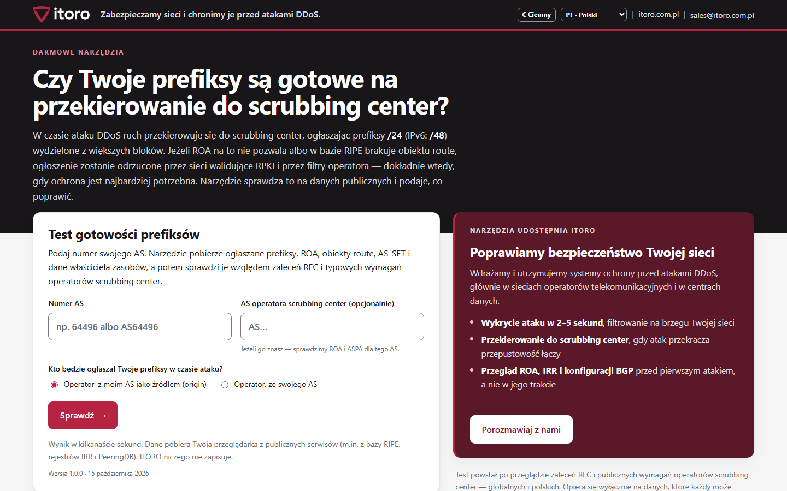
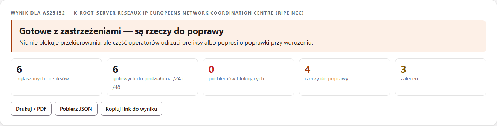
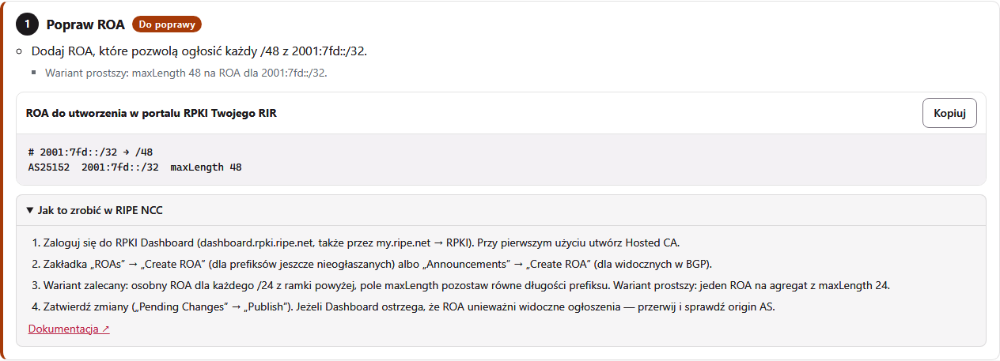
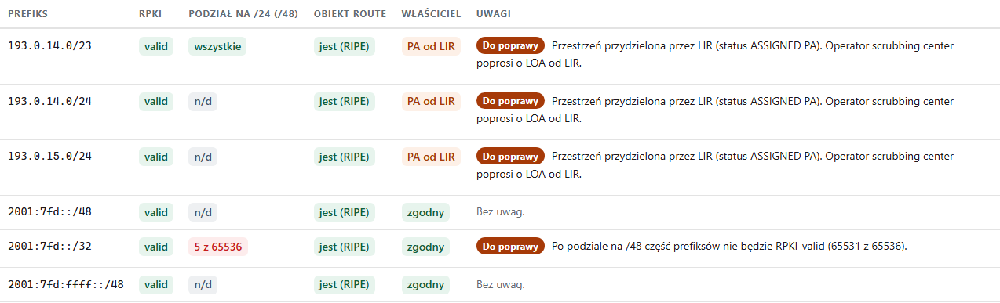
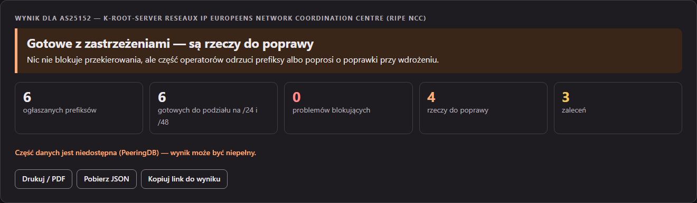

# Test gotowości prefiksów do scrubbing center


Wpisz numer AS i sprawdź, czy Twoje prefiksy da się przekierować do scrubbing center w czasie ataku DDoS. Narzędzie sprawdza, czy każdy /24 (/48) wydzielony z Twoich bloków będzie RPKI-valid i czy obiekty route są w bazie RIR. Ocenia też, czy będzie potrzebne LOA, oraz czy w porządku są AS-SET, kontakt abuse, PeeringDB i ASPA. Potem prowadzi przez poprawki krok po kroku, z instrukcją dla Twojego rejestru (RIPE NCC, ARIN, APNIC, AFRINIC albo LACNIC) i z gotowymi ROA, obiektami route oraz wzorem LOA do wklejenia.

Wszystko działa w przeglądarce. Nie ma serwera ani konta, a przeglądarka odpytuje publiczne serwisy bezpośrednio. Narzędzie udostępnia [ITORO](https://itoro.com.pl): chronimy sieci operatorów i centrów danych przed atakami DDoS.

**[English version → README.md](README.md)** ·
**Wersja online: https://itoro.com.pl/narzedzia/scrubbing/?jezyk=pl**



---

## Po co

Gdy atak przekracza przepustowość łączy, ruch kieruje się do scrubbing center przez ogłoszenie prefiksów /24 wydzielonych z większych bloków. Jeżeli ROA założono dokładnie na agregat, każdy taki /24 jest RPKI-invalid i sieci walidujące RPKI go odrzucają. Zmiany w RPKI i IRR docierają do filtrów po kilku godzinach, a RFC 9319 §5.1 mówi wprost, że ROA musi istnieć przed atakiem. Ten test wykrywa takie luki zawczasu.

## Co sprawdza

**Na poziomie AS:**
- AS istnieje i ogłasza prefiksy;
- kontakt abuse;
- aut-num i AS-SET w polityce eksportu;
- AS-SET zawiera Twój AS, jest w bazie RIR i ma nazwę hierarchiczną;
- AS-SET w PeeringDB;
- co najmniej dwóch operatorów nadrzędnych;
- ASPA zawiera AS operatora scrubbing center;
- ROA dla AS operatora, gdy to on jest źródłem ogłoszenia;
- nieaktualne obiekty route.

**Higiena AS-SET** (według wystąpień Lassego Jarlskova na BalticNOG 2025 i DKNOG15 oraz artykułu Douga Madory'ego i Joba Snijdersa „The Scourge of Excessive AS-SETs”):
- rozmiar po rozwinięciu wobec klientów widocznych w BGP;
- głębokość zagnieżdżeń i największe składowe;
- zbiory IXP i peerów w zbiorze klientów;
- członkowie niewidoczni w BGP;
- **kto włącza Twój AS do swoich AS-SET**; oznaczane są sieci bez relacji BGP, bo tak wyglądał wstęp do próby przejęcia ruchu opisany na DKNOG15.

**Na poziomie prefiksu:**
- długość nie większa niż /24 i /48;
- stan RPKI;
- **ile bloków /24 (/48) będzie RPKI-valid po podziale**;
- szerokie maxLength, ROA z AS0, ROA innych AS;
- obiekt route w bazie RIR (nie RADB, nie RIPE-NONAUTH), także dla każdego /24;
- obiekty route z innym origin;
- właściciel przestrzeni inny niż właściciel AS albo przestrzeń PA od LIR (potrzebne LOA);
- mniej szczegółowy prefiks ogłaszany przez inny AS (potrzebne LOA od operatora nadrzędnego).

Podstawę każdego testu (RFC, dokumenty RIPE i RIR, dokumentację operatorów) opisuje [ZRODLA.md](ZRODLA.md).

## Co dostajesz

| | |
|---|---|
| **Werdykt** | niegotowe / gotowe z zastrzeżeniami / gotowe, z licznikami |
| **Plan działań** | kroki w kolejności wykonania, każdy z instrukcją dla Twojego RIR i odnośnikiem do jego dokumentacji |
| **Gotowe obiekty** | ROA (osobno dla każdego /24 według RFC 9319 albo maxLength na agregacie), obiekty route w RPSL, wzór LOA z prefiksami i ich właścicielami |
| **Tabela prefiksów** | stan RPKI, ile /24 (/48) będzie valid po podziale, obiekt route, właściciel |
| **Lista kontrolna** | LOA, tunel i MSS, czas propagacji, ogłoszenie i wycofanie, pętle routingu, test na sucho, RTBH |
| **Eksport** | druk do PDF, JSON |







<sub>Zrzuty: AS25152 (K-root, RIPE NCC), 15 października 2026. Narzędzie ma motyw jasny i ciemny:</sub>



## Języki

Polski, angielski, niemiecki, francuski, hiszpański, portugalski, włoski, niderlandzki, czeski i rumuński. Strona wybiera język przeglądarki i ma przełącznik, a parametr `?jezyk=<kod>` wymusza wybrany język. Polski i angielski są wbudowane (`napisy.js`, `rir.js`); pozostałe języki ładują się z `jezyki/<kod>.js` dopiero wtedy, gdy są potrzebne.

## Uruchomienie na własnym komputerze

Z narzędzia można korzystać online pod adresem **https://itoro.com.pl/narzedzia/scrubbing/** albo pobrać je i uruchomić u siebie. Wersja pobrana robi wszystko to, co wersja online. Gdy masz zainstalowany **bgpq4**, dochodzą **listy prefiksów** budowane z Twoich AS-SET: liczba prefiksów, gotowe `prefix-list` dla Junos i zwykłe listy do pobrania. Listy prefiksów są tylko w wersji lokalnej. bgpq4 łączy się bezpośrednio z serwerami IRR, a strona w przeglądarce tego nie potrafi.

### 1. Pobranie

- **ZIP:** [pobierz aktualną wersję](https://github.com/itoro-pl/scrubbing-readiness-test/archive/refs/heads/main.zip). To to samo co przycisk **Code → Download ZIP** na stronie repozytorium. Numerowane wersje są na stronie [Releases](https://github.com/itoro-pl/scrubbing-readiness-test/releases). Rozpakuj w dowolnym miejscu.
- **git:** `git clone https://github.com/itoro-pl/scrubbing-readiness-test.git`

### 2. Wybór sposobu uruchomienia

| Sposób | Czego potrzebujesz | Listy prefiksów (bgpq4) |
|---|---|---|
| **A. Windows**: dwuklik na `start.bat` | [Python 3.8+](https://www.python.org/downloads/) (przy instalacji zaznacz *Add python.exe to PATH*) | nie; jeśli ich potrzebujesz, wybierz sposób C |
| **B. Linux / macOS**: `./start.sh` | Python 3 (zwykle już jest) i `bgpq4` (Debian/Ubuntu: `sudo apt install bgpq4`, macOS: `brew install bgpq4`) | tak, po zainstalowaniu bgpq4 |
| **C. Docker** (Windows, Linux, macOS) | [Docker Desktop](https://www.docker.com/products/docker-desktop/) na Windows i macOS albo Docker Engine na Linuksie | tak, bgpq4 jest w obrazie |

**Czy potrzebuję Dockera na Windowsie?** Tylko wtedy, gdy chcesz mieć listy prefiksów na Windowsie. Do całej reszty wystarczą `start.bat` i Python. Można też zainstalować bgpq4 w WSL i uruchomić tam `./start.sh`.

### 3. Uruchomienie

**A, Windows:** dwuklik na `start.bat`. Przeglądarka otworzy `http://127.0.0.1:8765/`. Żeby zatrzymać narzędzie, zamknij okno albo naciśnij Ctrl+C.

**B, Linux / macOS:**

```bash
./start.sh
```

**C, Docker**, w rozpakowanym katalogu:

```bash
docker compose up --build
```

a potem otwórz `http://127.0.0.1:8765/`. Bez Compose:

```bash
docker build -t itoro-scrubbing .
docker run --rm -p 127.0.0.1:8765:8765 itoro-scrubbing
```

Opcje lokalnego serwera: `start.bat --port 9000`, `./start.sh --port 9000` oraz `--bez-przegladarki` (bez otwierania przeglądarki). Serwer nasłuchuje tylko na `127.0.0.1`, a przykład dla Dockera też wystawia port wyłącznie na `127.0.0.1`.

Lokalny serwer (`serwer.py`, tylko biblioteka standardowa Pythona) serwuje pliki i udostępnia dwa punkty używane wyłącznie przez stronę otwartą lokalnie: `/api/status` i `/api/prefiksy?zbior=<AS-SET>&ip=4|6[&zrodlo=<IRR>]`, który uruchamia `bgpq4 -j`. Dane wejściowe są sprawdzane, a bgpq4 jest wywoływany bez powłoki.

Język wybiera się parametrem `?jezyk=pl`, `en`, `de`, `fr`, `es`, `pt`, `it`, `nl`, `cs` albo `ro` (domyślnie język przeglądarki). Wynik od razu: `?as=64496`, opcjonalnie z `&op=<AS operatora>&tryb=operator`.

## Źródła danych

| Dane | Serwis |
|---|---|
| ogłaszane prefiksy, ROA i ASPA, sąsiedzi BGP | RIPEstat Data API |
| obiekty route ze wszystkich IRR, rozwijanie AS-SET | IRR Explorer (NLNOG) |
| właściciel zasobu, kontakt abuse (wszystkie RIR) | RDAP; serwer wskazuje bootstrap IANA |
| polityka eksportu aut-num (region RIPE) | REST API bazy RIPE |
| AS-SET używany w filtrach | PeeringDB API |

Wszystkie te serwisy wysyłają nagłówki CORS. Jeśli serwer wysyła nagłówek Content-Security-Policy, `connect-src` musi dopuszczać domeny wymienione w README.md.

## Kontrola jakości

- `node skrypty/sprawdz-jezyki.js .` sprawdza, czy każde tłumaczenie ma tę samą strukturę co wersja angielska.
- `python skrypty/sprawdz-uklad.py <adres> <AS>` sprawdza układ we wszystkich językach w obu motywach (nachodzenie elementów, przewijanie w bok, błędy JS).
- `python skrypty/zrzuty.py <adres> <AS> zrzuty pl en` robi zrzuty do README (wymaga Playwright).

## Prywatność

Nie ma serwera ITORO. Numer AS trafia z przeglądarki prosto do publicznych serwisów. Wynik można wydrukować do PDF albo zapisać jako JSON.

## Ograniczenia

- W dużych sieciach szczegółowe zapytania obejmują pierwsze 150 prefiksów.
- Wymagań, których operatorzy nie publikują (treść LOA, tunele, community BGP), narzędzie nie testuje. Zamiast tego pokazuje je jako listę kontrolną.
- Portale RIR zmieniają menu, dlatego każda instrukcja odsyła do dokumentacji danego RIR.

## Licencja

Kod źródłowy jest na licencji **AGPL-3.0-or-later** (plik `LICENSE`). Treść merytoryczna (opisy testów, instrukcje dla RIR, teksty interfejsu, dokumentacja) jest na licencji **CC BY-SA 4.0** (plik `LICENSE-TRESC.md`). Dane z serwisów zewnętrznych i znak ITORO opisuje plik `NOTICE`.

---

## O ITORO

Wdrażamy i utrzymujemy systemy ochrony przed atakami DDoS, głównie w sieciach operatorów telekomunikacyjnych i w centrach danych. https://itoro.com.pl
